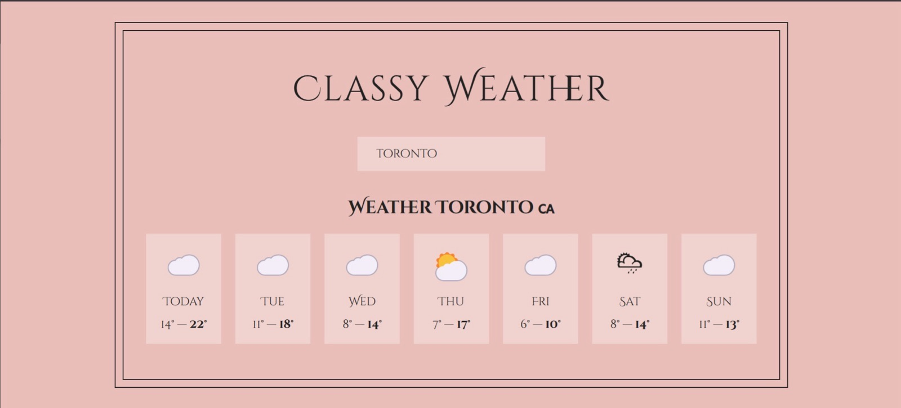

<div align="center">

# 🌤️ Classy Weather

A weather app built with React class components that shows a 7-day forecast for any location, using the Open-Meteo API.

<a href="https://miladmo68.github.io/classy-weather/"></a>
<a href="https://github.com/miladmo68/classy-weather"></a>
<a href="https://miladweb.com"></a>

**🔗 Live:** [miladmo68.github.io/classy-weather](https://miladmo68.github.io/classy-weather/)

</div>

<p align="center">
  
</p>

## ✨ Features

- Search any city
- 7-day forecast with weather icons
- Built with class components and lifecycle methods

## 🛠️ Tech Stack

   

## 🚀 Getting Started

**Prerequisites:** [Node.js](https://nodejs.org/) 18 or newer

**Install and run**

```bash
git clone https://github.com/miladmo68/classy-weather.git
cd classy-weather
npm install
npm start
```

## 📁 Project Structure

```
classy-weather/
├── public/
├── src/
└── package.json
```

## 👤 Author

**Milad Mohammadi** — Frontend-Focused Full-Stack Developer, Toronto 🇨🇦

[](https://miladweb.com)
[](https://www.linkedin.com/in/miladmo68/)
[](https://github.com/miladmo68)

<p align="center"><sub>If you like this project, consider giving it a ⭐</sub></p>
